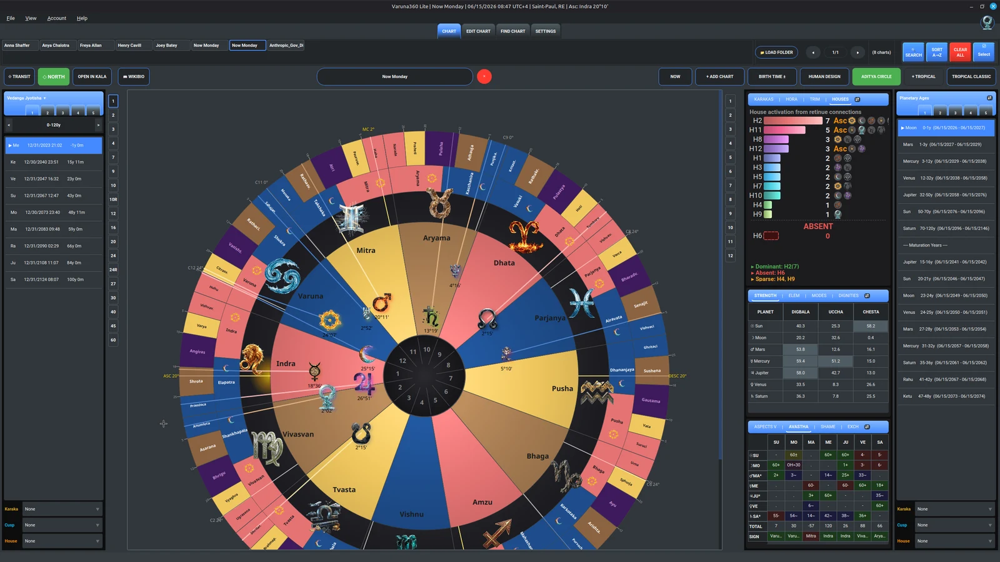

# Varuna360 Core

**Tropical Vedic astrology, open-sourced.**

Varuna360 Core is the free, open-source foundation of Varuna360, a desktop
astrology application that computes and visualizes charts in **Tropical,
Sidereal, and Aditya Circle** modes with Vedic concepts (Adityas,
Nakshatras, Vedic mythology). The author practices Tropical astrology,
but the software computes both Tropical and Sidereal with full ayanamsa
support. It is the same calculation engine that powers the Pro edition.

[](https://www.gnu.org/licenses/agpl-3.0)
[](https://360heartsinthesky.com/subscribe)



> **[Read the full manual](docs/help/manual.html)** for a complete walkthrough of every feature.

---

## Built on libaditya

Varuna360 Core is built on top of
[**libaditya**](https://gitlab.com/j0sh4rp3/libaditya), an astrological
calculation library created by Josh
([ninthhouse](https://gitlab.com/ninthhouse)). His work on libaditya gave
this project a solid, well-structured foundation for tropical, sidereal,
and Aditya zodiac calculations, divisional charts, Vimshottari Dasha,
Jaimini techniques, Human Design bodygraphs, Cards of Truth, and more.
Without his library, Varuna360 would not have the calculation backbone it
has today.

Many features inside libaditya do not yet have a GUI in Varuna360, but
they are fully functional from the command line or through an AI assistant.
If you have a Claude or ChatGPT/Codex subscription and know how to work
with AI, you can use libaditya's Python API directly to explore chart
calculations, vargas, dignities, and other techniques that the desktop
interface does not yet cover.

Josh has also created several mobile astrology apps. You can find them
across his various repositories on
[GitLab](https://gitlab.com/ninthhouse).

## What's in Core

- Every paid Core feature runs fully from source with no account
- Full interactive wheel chart with clickable planets and signs showing detailed descriptions
- 5 chart views: Wheel, South Indian, North Indian, Body Graph and Cards of Truth
- Two South Indian styles: a new conventional vector chart, or the classic artistic one
- Cards of Truth as its own view, and as an index drawn inside the wheel, the South Indian and the North Indian charts
- A second chart overlaid on the first, shown in the centre of the chart itself, so any two-chart comparison stays in one view
- Fullscreen on any chart with the `F` key, the way a video player does it
- Light and dark themes with color presets, plus a saturation slider to tone the whole interface
- 3 zodiac configurations: Aditya Circle (from Ernst Wilhelm's new research), Tropical Western, and Sidereal, with many ayanamsa options
- Human Design mode (computes the astrology layer of Human Design, bodygraph coming in a later update)
- Divisional charts (Varga D1 to D60)
- Trimsamsa and Hora panels with full chart creation (from Ernst Wilhelm's aditya technique)
- Interactive Vimshottari Dasha timeline
- CHTK file import and export (Kala compatibility)
- Automatic chart download from the web (Wikipedia biography search)
- Chart editing with an interactive themed map that shows the timezone and the Ascendant a place produces before you apply it
- Find Chart: search your chart database by planetary positions in any zodiac mode
- User profiles (like Chrome) to save charts in memory
- Autosave and Autoload, never lose your chart data again
- 16 Tajika aspects and Yoga detection plus Vedic planetary aspects
- Nabhasa Yogas panel: the twenty Akriti yogas detected, drawn and described
- Avastha relationship analysis (help and damage between planets), with refined strength, positive and negative rows split out, and its own fullscreen page
- Element and Modality breakdown with pie charts
- Per-area font sizes, so the chart, the tables and the panels scale independently of the interface
- Planetary strength (Shadbala) and Karakas panels
- Available on Windows, Linux and Mac

## What's in Varuna360 Pro

Pro is the AI edition of Varuna360, built for AI and fully connected to it.
Almost every task the software can do is also an AI tool, so you simply ask:
the AI computes the charts, finds the dates and searches for what you are
looking for, interactively with the program window. It is AGPL-3.0 too, like
everything else in Varuna360: Pro subscribers receive its corresponding
source. It is simply **not** published in this repository, and Core never
imports from it. If you want any of these, see
[Varuna360 Pro](https://360heartsinthesky.com/subscribe):

- All Core features
- Full AI interpretation of your charts, with local access to an AI
- Built for AI: the software's tasks are AI tools the AI runs for you
- Just ask: dates, ingresses, conjunctions and patterns found by the AI
- Interactive: the AI opens charts and shows its findings in the window
- Connect your own AI apps to Varuna360
- Eclipse pages: per-country Ascendant map, Saros Explorer, Eclipse Reading
- Transit page
- Solar return screen
- Chinese Lunar New Year page
- A manual for the AI features
- New screens and AI tools added over time

## Pricing

Varuna360 Core runs fully from this repository under AGPL-3.0, with no
account, no payment, no server call at launch. The desktop app is a
legitimate product you can test for free for as long as you want.
When you decide it is worth paying for, the website offers three
account tiers that unlock content on the web app.

### Website tiers

| Tier               | Price                        | Website access                                                                 |
|--------------------|------------------------------|---------------------------------------------------------------------------------|
| No account         | €0                           | Natal chart calculation, manual entry, element pie charts plus positions table, dominant Aditya description, Ascendant plus House Strength |
| Registered free    | €0                           | All No account features plus celebrity database, transit ring (current planets), 2 save slots |
| Explorer           | €9.99 / month                | All Registered free features plus CHTK file import, full transit calculation plus Now button, Dignified Planets panel, Divine Cow (Kamadhenu) panel, Planet Strength (Shadbala) panel, 20 save slots |

### Desktop and mobile distribution

| Distribution       | Price                        | What you get                                                                   | Status      |
|--------------------|------------------------------|---------------------------------------------------------------------------------|-------------|
| Source (this repo) | €0                           | Every Core feature, AGPL-3.0, clone and build                                  | Available   |
| Lite Mobile        | From €3 / month              | The Aditya wheel on Android: Hora and Trimsamsa rings, Avastha, 16 Tajika aspects, live transits and live Ascendant | Available |
| Lite Desktop       | From €3 / month, suggested €14.99 / month | Same Core features as source plus pre-built installer, auto-updates, email help, matching website tier | Coming Soon |
| Pro                | €14.99 / month               | Everything in Core plus the "What's in Varuna360 Pro" list above               | Coming Soon |

Every paid tier is a monthly recurring subscription, priced in EUR.

**You choose what you pay.** Lite Desktop and Lite Mobile use a slider
starting at €3 / month. €14.99 is what the author suggests, not a gate:
salaries are not the same everywhere, and there is no proof to provide and
no country box to tick. Pay what your situation allows, and adjust later if
it changes.

Two thresholds are worth knowing. From €9.90 / month, Lite Desktop includes
the mobile app. From €11 / month, it also includes the Explorer website
tier; below €11 the two subscriptions simply coexist.

**€14.99 is the Pro starting price.** Pro is stable and its AI tools have
been tested for a long time, but a few areas are still being improved. The
price will probably rise to €20 / month over time, as Pro is fully tested
and grows.

The bundled installers and the Pro subscription go live on
[360heartsinthesky.com](https://360heartsinthesky.com) when ready. Building
from this source stays free forever under AGPL-3.0.

## Running from source

```bash
git clone https://github.com/astrologielorris/varuna360-core.git
cd varuna360-core
python3 -m venv venv
source venv/bin/activate          # Windows: venv\Scripts\activate
pip install -r requirements.txt
python apps/core_gui_qt.py
```

Use Python 3.12. The Swiss Ephemeris data files come inside the `libaditya`
package that `pip install -r requirements.txt` installs, so there is nothing
else to download.

## Building the macOS app

The macOS app is built with Nuitka on a Mac of the architecture you want
(Apple Silicon gives an arm64 app, Intel gives an x86_64 app). These are the
same steps the GitHub workflow `.github/workflows/build-macos.yml` runs.

1. Install the Xcode command line tools (`xcode-select --install`) and
   Python 3.12 from python.org.
2. Create the build environment and install the dependencies:

   ```bash
   python3.12 -m venv .venv
   .venv/bin/python -m pip install --upgrade pip
   .venv/bin/python -m pip install --only-binary cryptography -r requirements.txt
   .venv/bin/python -m pip install nuitka==4.0.7 ordered-set zstandard imageio
   ```

   `--only-binary cryptography` matters on Intel Macs: it picks the newest
   cryptography release that still has a ready-made Intel wheel.
3. Build the app bundle, then package it:

   ```bash
   bash scripts/build_macos_nuitka.sh
   bash scripts/package_macos_dmg.sh
   ```

The `.dmg` and `.zip` land in `dist/macos/`. The app is not signed with an
Apple Developer ID, so on first launch macOS blocks it; the packaging script
prints how to open it anyway.

## License

The whole of Varuna360 is licensed under the **GNU AGPL v3.0**, Core and Pro
alike. Pro is a paid edition, not a proprietary one. See [`LICENSE`](LICENSE)
for the full text and [`NOTICE`](NOTICE) for copyright details. The author,
Lorris Turpin, holds the copyright and, as sole copyright holder, reserves
the right to license his own code under other terms as well. That reservation
does not affect the AGPL-3.0 grant on the copy you have.

Two things are not under the AGPL-3.0:

- **The name and the icons.** "Varuna360", "360 Hearts in the Sky" and the
  Varuna360 cat icons are trademarks of Lorris Turpin. A modified version must
  carry its own name and icon; you may say it is based on Varuna360.
- **The author's astrological texts.** The Ascendant guide and the
  user manual are Lorris Turpin's
  writing, with all rights reserved. They may travel unchanged inside copies
  of the program, but may not be edited, translated or reused elsewhere
  without permission.

The exact terms and the list of files are in [`NOTICE`](NOTICE).

## Contributing

This repository is a **read-only mirror** of an internal canonical
codebase. Direct pull requests are **not accepted at this time.** Please
see [`CONTRIBUTING.md`](CONTRIBUTING.md) for how to report bugs and
propose patches.

## Security

To report a security vulnerability, see [`SECURITY.md`](SECURITY.md).
**Do not** open a public GitHub issue for security reports.

## Links

- **Website:** https://360heartsinthesky.com
- **Upgrade to Pro:** https://360heartsinthesky.com/subscribe
- **Issues:** https://github.com/astrologielorris/varuna360-core/issues

---

<!-- RELEASE-BLOCK:BEGIN -->
<!-- Generated at sync time from VERSION + CHANGELOG.md. Edits here are
     overwritten on the next sync; edit CHANGELOG.md instead. -->

## Current release: 6.0.0 (2026-10-29)

Varuna360 6.0.0 brings a new Find Chart tab, the strength of the chart drawn
directly on the chart, six new layers on the South Indian chart, and a design
that adapts to every screen size.

Some descriptions were removed from this version for copyright reasons. The
Trimsamsa descriptions are among them; new ones are being written and should
come back in a coming version.

### Added

- **A new Find Chart tab.** Built by Josh on a design by Lorris. Search your
  whole chart library in many systems at once: planet positions in the
  Aditya Circle, Tropical and Sidereal zodiacs, whole sign houses,
  nakshatras, dignities, avasthas, the retinue, Human Design gates and
  channels, Cards of Truth and Shayanadi. Each result opens as a quick
  chart preview, and long searches show their progress in the status bar.
- **The Library.** Check Charts finds damaged chart files, wrong time zones
  and copies of the same chart that disagree. Old CHTK files convert to the
  open TOML format, with every original kept as a backup. Rate and Sort
  lets you rate your charts and sort the library by your ratings.
- **Strength shown on the chart.** Click a strength key in the Strength panel
  (Digbala, Uccha, Chesta, Duc Bala) and the chart lights up: the planets
  glow with their strength, and each sign takes the colour of its lord's
  strength, Aditya signs included. Two styles, V1 and V2.
- **Six new layers on the South Indian chart:**
  - the strength display above, in the sign squares;
  - the Vedic aspects drawn in the center;
  - the Tajika aspects drawn in the center, with a Tour key that plays them
    one by one;
  - exchange chains (THREAD key), every sign exchange drawn as a metal chain,
    ranked from gold to rust, on the wheel too;
  - the dignity overlay (DIGNITY key), one varga at a time;
  - an optional degree ruler around the center drawings.
- **A design for every screen size.** The main chart tab adapts to small and
  large screens. The info panels beside the chart fold away and can be
  swapped. The dasha column can be full, folded into a thin rail, or moved
  below the chart, so the chart gets the space it needs.
- **The macOS style panel headers** across the main chart tab, and an
  improved design in almost every part of the app.
- **Two charts side by side**, with a quick swap between them.
- **Back and forward** through the charts you viewed in a session.
- **Text under the planets.** F11 cycles between degrees, names, Human Design
  gates and nakshatras.
- **The full Nakshatra panel**, and the nakshatra descriptions, credited to
  Ernst Wilhelm and Michael Reed. Double click a nakshatra on the wheel to
  read it.
- **Hover the Hora and Trimsamsa rings** on the wheel to read their house
  position.
- **Custom ayanamsa** in Settings.
- **Simple vector sign symbols**, signs shown as numbers if you prefer, and a
  colour editor for the sign symbols.
- **Dark Orange theme** and a Deep dark option. A new install opens in the
  Light Blue theme, with the strength colours ready to use.
- **French descriptions** of the Adityas.
- **Screen recorder** on Linux, Windows and macOS, and **local voice input**.

Earlier releases are in [CHANGELOG.md](CHANGELOG.md).

<!-- RELEASE-BLOCK:END -->
